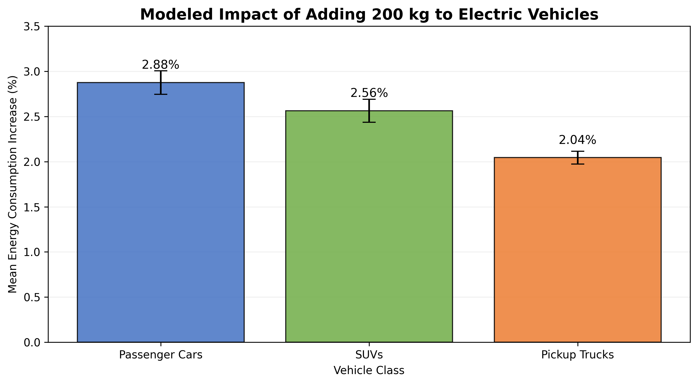

# AIPI 510 Project 2: EV Weight and Energy Consumption

## Project Overview

For this project, I wanted to explore how adding weight to an electric vehicle affects its energy consumption and whether the relative impact differs between passenger cars, SUVs, and pickup trucks.

I used real EPA energy-consumption data as a baseline and a simplified rolling-resistance equation to simulate adding 200 kg to each vehicle. I then compared the modeled percentage increase in energy consumption across the three vehicle groups using statistical analysis.

## Dataset

**Source:** [EPA FuelEconomy.gov](https://www.fueleconomy.gov/feg/download.shtml)

- Electric vehicles from model years 2020–2025
- 914 EV configurations after initial cleaning
- 900 configurations included in the simulation
- Final balanced sample: 180 configurations (60 per vehicle group)
- One randomly selected record per unique make/model combination

## Simulation Method

The simulation estimates the additional energy needed to overcome rolling resistance when 200 kg is added to an EV.

The following assumptions were used:

- Added mass: 200 kg
- Rolling-resistance coefficient: 0.01
- Gravity: 9.81 m/s²
- Drivetrain efficiency: 90%
- Flat-road, constant-speed conditions

The model estimates approximately **6.06 Wh/km** of additional energy consumption for every vehicle. This value was used to calculate the percentage increase relative to each vehicle's EPA baseline.

## Statistical Analysis

I used a power analysis with Cohen's f = 0.25, 80% power, and a significance level of 0.05 to estimate the required sample size.

The analysis included:

- Shapiro-Wilk tests for normality
- Levene's test for equal variances
- Welch's one-way ANOVA
- Games-Howell post-hoc comparisons
- Eta-squared effect size and 95% confidence intervals

Welch's ANOVA was selected because the vehicle groups had unequal variances.

## Results

| Vehicle Group | Mean Modeled Increase | 95% Confidence Interval |
|---|---|---|
| Passenger Cars | 2.88% | 2.75%–3.01% |
| SUVs | 2.56% | 2.44%–2.69% |
| Pickup Trucks | 2.04% | 1.97%–2.12% |

Welch's ANOVA found a statistically significant difference between the groups, F(2, 107.74) = 73.66, p < 0.001. All three pairwise comparisons were also statistically significant.

The observed eta-squared was 0.3859.



## Project Files

- `data/` — Original EPA data, cleaned data, simulation results, and final sample
- `scripts/prepare_ev_data.py` — Cleans and prepares EPA data
- `scripts/explore_ev_data.py` — Explores energy consumption across EVs
- `scripts/create_experiment_data.py` — Generates the simulated results
- `scripts/statistical_analysis.py` — Reproducible power analysis, final sampling, statistical tests, and figure generation
- `notebooks/statistical_analysis.ipynb` — Optional exploratory notebook
- `ev_weight_results.png` — Final results graph
- `requirements.txt` — Python dependencies

## How to Run

Install the required Python packages:

```bash
pip install -r requirements.txt
```

From the project root, run the scripts in order:

```bash
python scripts/prepare_ev_data.py
python scripts/explore_ev_data.py
python scripts/create_experiment_data.py
python scripts/statistical_analysis.py
```

The last script regenerates `data/ev_final_sample.csv` and `ev_weight_results.png` and prints the statistical results. No Jupyter notebook is required. Run the commands from the project root. The notebook is included only as optional exploratory work.

## Limitations

This was a computational experiment rather than a physical test of electric vehicles. The additional energy consumption was calculated using a simplified physics model, not measured directly.

The model assumes the same absolute energy increase for every EV. Therefore, the differences in percentage increases are driven by differences in EPA baseline consumption.

The results describe the behavior of the simulation and should not be interpreted as proof of real-world differences in how vehicle classes respond to added weight.

## AI Assistance

I used ChatGPT to help understand the physics behind rolling resistance, develop and troubleshoot the Python code, and understand the statistical methods and results. I reviewed the calculations, verified that the code ran correctly, and interpreted the findings as part of completing the project.